# Alexsander Corvello da Silveira

### Senior QA Engineer · SDET · AI Test Engineer · Applied Machine Learning

📍 Brazil (UTC-3) &nbsp;|&nbsp; 🧪 10+ years in Software Quality &nbsp;|&nbsp; 🤖 Stateful AI Agents & Local LLMs &nbsp;|&nbsp; 📊 Data Analysis & ML

💼 **Open to Remote Global Opportunities:** Senior QA Engineer / SDET / Data QA Specialist / AI Test Engineer.
🎓 **Currently pursuing an MBA in Applied Artificial Intelligence (UNISINOS, 2026).**

---

## 👋 About Me

I am a **Senior Quality Engineer / SDET** with 10+ years of experience, evolving from advanced test automation (Playwright, Cypress, Selenium) to **Python data pipelines, predictive models and AI agents that run locally**.

My core question:
> **How can we use AI and Data Science to move from reactive testing to predictable QA, without compromising data governance?**

My QA rigor, rooted in reproducibility, strict validation and data integrity, shapes how I approach Data Science: I don't just consume AI models, I audit them with explicit metrics.

<b>More about my focus</b>

 

I design reproducible **Data Engineering and Machine Learning pipelines** in Python. I work with **Unsupervised Learning** for cyber anomaly detection, **Deep Reinforcement Learning** benchmarks, and **Stateful Agentic Workflows (LangGraph)** with local LLMs (Ollama) to automate evaluation loops while keeping project data on-premises.

---

## 🛠️ Tech Stack

| Domain | Core Tools & Frameworks |
|---|---|
| **Data Analysis & ML** | Python, pandas, NumPy, SciPy, scikit-learn, mlxtend, Jupyter Notebooks |
| **Deep Learning & AI Agents** | LangGraph, Pydantic, PyTorch, Ollama (Local LLMs), Stable-Baselines3, Gymnasium |
| **Data & Core Engineering** | SQL, PostgreSQL, Oracle, Apache Kafka, Azure Blob Storage, Data Modeling |
| **Test Automation (UI & API)** | Playwright (JavaScript/Python), Cypress, Selenium (Java), pytest, requests, RestAssured |
| **CI/CD & DevOps for QA** | Jenkins (Stage View), Docker, Docker Compose, SonarQube Quality Gates |
| **Methodologies & Metrics** | BDD, TDD, Static Code Analysis, Data Telemetry, Data Drift, Scrum, Kanban |
| **Data Visualization** | Plotly Express, Seaborn, Matplotlib, OpenCV |

---

## 🚀 Featured Projects: The Intelligent QA Ecosystem

Instead of isolated repositories, my work is organized as an **interconnected AI & QA data ecosystem**. Each project covers one technical pillar (AI Engineering, Data Science or DevOps) of a continuous delivery lifecycle.

**Status legend:** ✅ Available &nbsp;·&nbsp; 🚧 In development / R&D &nbsp;·&nbsp; 💡 Planned

```mermaid
flowchart TD
    Req["Business User Stories"] --> Gen["Test Case Generation<br/>MCP and LLMs"]
    Gen -->|"Generated test scripts"| Pipe["Multi-Framework QA Pipeline<br/>Jenkins, Docker, SonarQube"]

    subgraph Ops ["Intelligent Operations and Analytics Layer"]
        direction LR
        ACV["Automation Code Validator<br/>LangGraph and Ollama"] -->|"Validation data"| Dash["Dashboard Metrics Quality"]
        Dash -->|"Consolidated telemetry"| Pred["Software Error<br/>Prediction Model"]
    end

    Pipe -->|"Failure logs"| ACV
    Pipe -->|"Execution metrics"| Dash
    Pipe -->|"Telemetry and logs"| Pred
    Pred -->|"Risk feedback"| Gen

    style ACV fill:#1f2d3d,stroke:#38bdf8,stroke-width:2px
    style Dash fill:#111827,stroke:#10b981,stroke-width:1px,stroke-dasharray: 5 5
    style Ops fill:transparent,stroke:#374151,stroke-width:1px,stroke-dasharray: 3 3
```

---

### 🤖 1. Shift-Left: Intelligent Generation & Execution

#### 🚧 [AI Test Case Generation from User Stories (MCP + Playwright)](https://github.com/acorvello/REPLACE-WITH-REPO-NAME)
*   **Ecosystem role:** The genesis layer. Runs before pipeline execution, turning business requirements into structured test scripts.
*   **Engineering:** A generative solution using the **Model Context Protocol (MCP)** and LLMs to parse user stories, extract data schemas and generate UI test scripts for Playwright.
*   **Feedback loop:** Designed to take failure-risk signals from the *Software Error Prediction* phase to prioritize coverage.

#### ✅ [Multi-Framework QA Pipeline & Static Code Analysis (SonarQube)](https://github.com/acorvello/docker-test-env)
*   **Ecosystem role:** The execution and telemetry engine. Containerizes, runs and monitors test suites, collecting unified telemetry.
*   **DevOps orchestration:** Docker Compose environment (Jenkins, parallel runners for Playwright, Cypress and API tests, and a target application) for consistent environments across runs.
*   **Data aggregation:** SonarQube Quality Gates inside Jenkins enforce code governance. The pipeline aggregates logs, videos, screenshots and JUnit XML metrics, forming the **core dataset** for the AI modules.
*   **Test repositories:** [e2e-cypress-js](https://github.com/acorvello/e2e-cypress-js) · [e2e-playwright-python](https://github.com/acorvello/e2e-playwright-python) · [api-testing](https://github.com/acorvello/api-testing)

---

### 🧠 2. Shift-Right: Log Analysis & Predictive Analytics

#### ✅ [Automation Code Validator (LangGraph & Ollama)](https://github.com/acorvello/REPLACE-WITH-REPO-NAME)
*   **Ecosystem role:** The failure-triage layer. Analyzes automation logs and recommends fixes without manual log reading.
*   **AI architecture:** A **stateful agentic workflow** built with LangGraph in Python (`Parser → Evaluator → Fixer`), running open-source LLMs locally via Ollama. It classifies failures such as ambiguous or flaky selectors and infrastructure timeouts, and recommends non-destructive locator fixes, falling back to `NO_SAFE_FIX` when context is ambiguous.
*   **Deterministic output:** Strict Pydantic schemas and heuristics validate and override raw LLM output.

#### 🚧 [Predictive Software Error Model](https://github.com/acorvello/REPLACE-WITH-REPO-NAME) *(R&D phase)*
*   **Ecosystem role:** The continuous feedback loop. Analyzes historical results to anticipate failures.
*   **Machine learning:** A predictive pipeline trained on CI/CD telemetry logs, estimating failure probability *before* deployment.
*   **Closing the loop:** Feeds failure patterns back into test case generation to focus coverage on historically error-prone rules and paths.

---

### 📊 3. Centralized Analytics Layer

#### 💡 Dashboard Metrics Quality *(planned)*
*   **Ecosystem role:** The unified insights hub, consolidating telemetry from generation, execution and prediction.
*   **Engineering focus:** An interface that translates QA metrics, data drift and automation coverage into business-ready health indicators.

---

## 📈 Specialized Data Science Portfolio

### 📊 [Advanced Artificial Intelligence Portfolio: Data Analysis](https://github.com/acorvello/data-analysis)
A standalone repository with three reproducible notebook projects: unsupervised cybersecurity analytics, a deep reinforcement learning benchmark, and biomedical image segmentation, each with structured metrics.

#### 🛡️ Unsupervised Cyber Threat Intelligence Pipeline
*   **The challenge:** Processing noisy, unlabeled firewall logs to identify stealthy infrastructure attacks.
*   **Data engineering:** Shifted the analysis from raw packets to a behavioral matrix aggregated per `Source IP`, using Python and SQL.
*   **Statistical cleansing:** Low-variance filtering plus automated multicollinearity pruning (VIF / correlation threshold) to remove geometric bias from distance calculations.
*   **Multi-model evaluation:** K-Means, Hierarchical Clustering (Ward, with cophenetic validation) and DBSCAN (isolating malicious IPs as noise).
*   **Visualization:** Interactive 2D PCA and t-SNE projections in Plotly, in a SOC-dashboard style.

#### 🚀 Lunar Lander v3: Deep Reinforcement Learning Benchmark
*   **Architecture:** DQN, PPO and A2C compared with Stable-Baselines3 and Gymnasium over 300k timesteps and independent seeds (discrete-action environment).
*   **Data pipeline:** In-memory training stream with adaptive reward normalization (`VecNormalize`).
*   **Model auditing:** Shannon Entropy tracking to detect policy degradation and policy collapse.

#### 🧬 Biomedical Semantic Segmentation Pipeline
*   **Architecture:** U-Net with multi-scale skip connections for joint-space boundary tracking in knee radiographs.
*   **Hardware optimization:** `VRAMKneeDataset` GPU caching layer and target-aware augmentations with `torchvision.transforms.v2`.
*   **Metrics:** **0.9569 mIoU** and **0.9772 Dice** on the held-out test set.

---

## 🧠 Core Engineering Lessons

*   **Feature cleanliness over distance:** In clustering pipelines, pruning highly correlated variables matters; redundant signals warp distance-based algorithms like K-Means.
*   **Model evaluation beyond accuracy:** Auxiliary metrics such as Shannon action entropy reveal policy traps that reward tracking alone misses.
*   **Static governance prevents debt:** Running code scanners (SonarQube) inside CI/CD keeps brittle test code and fragile locators out of the main branch.
*   **Retry-ability over fixed waits:** Replacing arbitrary pauses (like `cy.wait`) with asynchronous state polling substantially stabilizes multi-container test infrastructure.

---

## 🎓 Education

*   MBA in Applied Artificial Intelligence, UNISINOS (in progress, 2026)
*   Postgraduate Degree in Project Management, UNISINOS (2022)
*   Bachelor's Degree in Information Systems, UNISINOS (2010)

---

## 📫 Let's Connect

*   💼 LinkedIn: [linkedin.com/in/acorvello](https://linkedin.com/in/acorvello)
*   📧 Email: [alexsander.corvello@gmail.com](mailto:alexsander.corvello@gmail.com)
*   🐙 GitHub: [@acorvello](https://github.com/acorvello)

---

**Core competencies:** Test Automation (Playwright, Cypress, Selenium) · CI/CD (Jenkins, Docker, SonarQube) · AI Agents (LangGraph, Ollama, MCP) · Machine Learning (scikit-learn, PyTorch) · Data Quality
