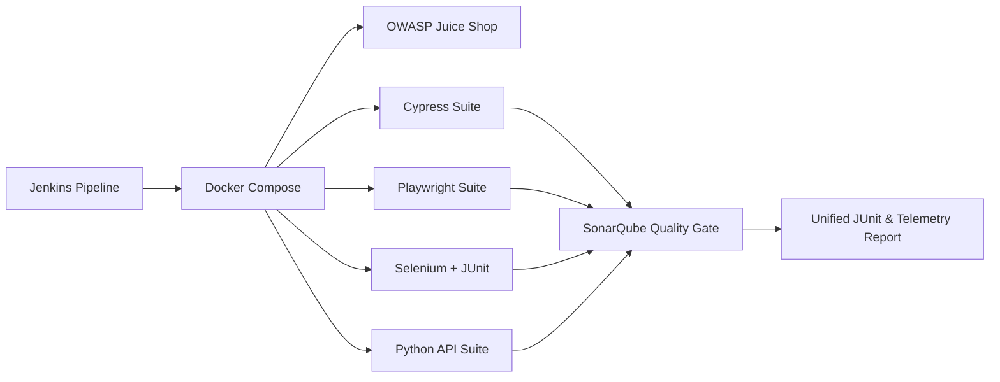

# Alexsander Corvello 

### Senior QA Engineer · Data QA · AI Engineer · Applied Machine Learning

📍 Brazil &nbsp;|&nbsp; 🧪 10+ years in Software Quality &nbsp;|&nbsp; 📊 Data Analysis & Machine Learning &nbsp;|&nbsp; 🤖 Stateful AI Agents & LLM Architectures

---

## 👋 About me

I am a **Senior Quality Engineer / SDET** bridging the gap between Software Quality, **Data Analytics**, and **Applied Artificial Intelligence**. My engineering journey spans over a decade, evolving from advanced test automation frameworks (Playwright, Cypress, Selenium) to building intelligent data pipelines and predictive systems.

Today, my core focus answers a critical industry challenge:
> **How can we leverage Advanced AI and Data Science to transition from traditional reactive testing into autonomous, highly predictable QA frameworks without compromising data governance?**

To achieve this, I design reproducible **Data Engineering and Machine Learning pipelines** in Python. I specialize in **Unsupervised Learning** for cyber anomaly detection, **Deep Reinforcement Learning** for telemetry optimization, and **Stateful Agentic Workflows (LangGraph)** to automate complex evaluation loops. 

My QA rigor—rooted in reproducibility, strict validation, and data integrity—directly fuels my approach to Data Science. I don't just consume AI models; I audit and engineer them using metrics to measure system health and behavior.

🎓 **Currently pursuing an MBA in Applied Artificial Intelligence (UNISINOS, 2026)**.  
💼 **Open to Remote Global Opportunities:** Senior QA Engineer / SDET / Data QA Specialist / AI Test Engineer.

---

## 🛠️ Tech stack

| Domain | Core Tools & Frameworks |
|---|---|
| **Data Analysis & ML** | Python, pandas, NumPy, SciPy, scikit-learn, mlxtend, Jupyter Notebooks |
| **Deep Learning & AI Agents**| LangGraph, LangChain, PyTorch, Ollama (Local LLMs), Stable-Baselines3, Gymnasium |
| **Data & Core Engineering** | SQL, PostgreSQL, Oracle, NoSQL, Apache Kafka, Azure Blob Storage, Data Modeling |
| **Test Automation (UI & API)**| Playwright (JavaScript/Python), Cypress, Selenium (Java), pytest, requests, RestAssured |
| **CI/CD & DevOps for QA** | Jenkins (Stage View), Docker, Docker Compose, SonarQube Quality Gates |
| **Methodologies & Metrics** | BDD, TDD, Static Code Analysis, Data Telemetry, Data Drift, Scrum, Kanban |
| **Data Visualization** | Plotly Express, Seaborn, Matplotlib |

---

## 🚀 Featured projects

### 📊 Data Analysis & Applied AI Architecture: [data-analysis](https://github.com)

A repository of reproducible Jupyter notebooks applying machine learning algorithms to complex domains, complete with pipeline diagnostics and interactive dashboards.

#### 🛡️ Unsupervised Cyber Threat Intelligence Pipeline
*   **The Challenge:** Processing massive, noisy, unlabeled corporate firewall log streams to identify stealthy infrastructure attacks.
*   **Data Engineering:** Shifted evaluation from raw network packets to a behavioral matrix aggregated per `Source IP`.
*   **Statistical Cleansing:** Implemented unsupervised feature selection using a low-variance filter combined with automated VIF (Variance Inflation Factor) pruning to remove geometric bias from multi-dimensional distance calculations.
*   **Machine Learning Multi-Model Evaluation:** Compared K-Means, Hierarchical Clustering (Ward with Cophenetic validation), and DBSCAN (isolating malicious IPs as outlier noise).
*   **Manifold Visualization:** Built interactive 2D PCA and t-SNE projections via Plotly (SOC dashboard style) to trace network anomalies.
*   **Market Keywords:** *Unsupervised Learning, Clustering, PCA, t-SNE, Apriori, FP-Growth, Python, SQL, Threat Intelligence*.

#### 🚀 Lunar Lander v3: Deep Reinforcement Learning Benchmark
*   **Architecture:** Evaluated DQN, PPO, and A2C algorithms using Stable-Baselines3 and Gymnasium over 300k timesteps under independent seeds.
*   **Data Pipeline:** Configured a 100% in-memory data stream with adaptive reward normalization (`VecNormalize`) to stabilize training convergence.
*   **Model Auditing:** Utilized Shannon Entropy tracking to monitor policy degradation and prevent neural network policy collapse.

| Algorithm | Mean reward | Safe landing rate | Action entropy | Policy health |
|:---:|:---:|:---:|:---:|:---:|
| 🏆 **PPO** | **+184.20** | **93.3%** | 1.91 bits (max 2.00) | Healthy and dynamic |
| **A2C** | -42.10 | 15.0% | 1.10 bits | Late degradation |
| **DQN** | -125.40 | 0.0% | 0.32 bits | Collapse alert |

---

### 🤖 AI-Agentic Testing & Generative QA Ecosystem

A suite of frameworks where Generative AI, Large Language Models, and graph computing intersect with automated software quality.

*   **Validation in Cypress using LangGraph:** An advanced **Agentic Workflow** built with LangChain and LangGraph in Python. It orchestrates stateful, multi-node loops (`START → nodes → decide() → report → END`) calling OpenAI APIs to audit Cypress files for flakiness, weak selectors, and code smells, generating structural Markdown verdicts.
*   **Predictive Software Error Model:** A machine learning pipeline trained on raw CI/CD telemetry logs to run pattern recognition and predict software failure probabilities *before* deployment stages.
*   **Performance Optimization in Test Case Generation:** An enterprise-level generative solution utilizing the **Model Context Protocol (MCP)** and LLMs to read user stories, extract data schemas, and automatically generate high-coverage UI test scripts for Playwright.
*   **Local AI Governance (Ollama):** Local LLM orchestration (Ollama + Qwen 3) combined with Cline to safely expedite code generation without exposing sensitive corporate telemetry.

---

### 🔧 Multi-Framework QA Pipeline & Static Code Analysis (SonarQube)

A production-grade CI/CD environment built to execute parallelized testing frameworks against the [OWASP Juice Shop](https://owasp.org) target application.

*   **DevOps Orchestration:** Entirely containerized via Docker and Docker Compose (Jenkins server, test runners, headless browsers, target app), ensuring 100% environment parity.
*   **Static Code Analysis:** Embedded a **SonarQube Quality Gate** within the Jenkins Stage View to enforce structural code governance, security gates, and code metrics across multi-language repositories (Python, JavaScript, Java).
*   **Data Telemetry:** Designed the execution workflow to aggregate system logs, test artifacts (videos/screenshots), and unified JUnit xml metrics to serve as the structural dataset for predictive AI evaluation.

---

## 🧠 Core Engineering Lessons

*   **Features Cleanliness Over Distance:** In clustering pipelines, removing highly correlated variables using VIF is non-negotiable; redundant signals heavily warp distance-based algorithms like K-Means.
*   **Model Evaluation Beyond Accuracy:** Tracking auxiliary metrics like Shannon Action Entropy is vital to audit neural network health, revealing policy traps that standard reward tracking misses.
*   **Static Governance Prevents Debt:** Injecting automated code scanners (SonarQube) directly inside the CI/CD pipeline stops brittle test code and dynamic locator flakiness from entering production repositories.
*   **Retry-ability > Fixed Waits:** Eliminating arbitrary pauses (like `cy.wait`) in favor of asynchronous state pooling completely stabilizes multi-container testing infrastructure.

---

## 🎓 Education

*   **MBA in Applied Artificial Intelligence** – UNISINOS (In progress, 2026)
*   **Postgraduate Degree in Project Management** – UNISINOS (2022)
*   **Bachelor’s Degree in Information Systems** – UNISINOS (2010)

---

## 📫 Let's connect

- 💼 **LinkedIn:** [://linkedin.com](https://www.://linkedin.com)
- 📧 **Email:** [alexsander.corvello@gmail.com](mailto:alexsander.corvello@gmail.com)
- 🐙 **GitHub:** [@acorvello](https://github.com)

---

Keywords: Senior QA Engineer, SDET, Data QA Engineer, Quality Engineering, Data Analysis, Machine Learning, Deep Reinforcement Learning, Unsupervised Learning, Clustering, Anomaly Detection, VIF, SonarQube, Quality Gates, Static Code Analysis, Model Context Protocol, MCP, Playwright, Cypress, Selenium, Jenkins, Docker, CI/CD Pipelines, Agentic Workflows, LangChain, LangGraph, Ollama, TensorFlow, PyTorch, pandas, scikit-learn, Remote Engineer.
