# Alexsander Corvello da Silveira

### Senior QA Engineer · Data QA · AI Engineer · Applied Machine Learning

📍 Brazil &nbsp;|&nbsp; 🧪 10+ years in Software Quality &nbsp;|&nbsp; 📊 Data Analysis & Machine Learning &nbsp;|&nbsp; 🤖 Stateful AI Agents & Local LLM Architectures

---

## 👋 About Me

I am a **Senior Quality Engineer / SDET** bridging the gap between Software Quality, **Data Analytics**, and **Applied Artificial Intelligence**. My engineering journey spans over a decade, evolving from advanced test automation frameworks (Playwright, Cypress, Selenium) to building intelligent data pipelines, predictive systems, and deterministic AI agents.

Today, my core focus answers a critical industry challenge:
> **How can we leverage Advanced AI and Data Science to transition from traditional reactive testing into autonomous, highly predictable QA frameworks without compromising data governance?**

To achieve this, I design reproducible **Data Engineering and Machine Learning pipelines** in Python. I specialize in **Unsupervised Learning** for cyber anomaly detection, **Deep Reinforcement Learning** for telemetry optimization, and **Stateful Agentic Workflows (LangGraph)** to automate complex evaluation loops locally. 

My QA rigor—rooted in reproducibility, strict validation, and data integrity—directly fuels my approach to Data Science. I don't just consume AI models; I audit and engineer them using strict metrics to measure system health and behavior.

🎓 **Currently pursuing an MBA in Applied Artificial Intelligence (UNISINOS, 2026)**.  
💼 **Open to Remote Global Opportunities:** Senior QA Engineer / SDET / Data QA Specialist / AI Test Engineer.

---

## 🛠️ Tech Stack

| Domain | Core Tools & Frameworks |
|---|---|
| **Data Analysis & ML** | Python, pandas, NumPy, SciPy, scikit-learn, mlxtend, Jupyter Notebooks |
| **Deep Learning & AI Agents**| LangGraph, Pydantic, PyTorch, Ollama (Local LLMs), Stable-Baselines3, Gymnasium |
| **Data & Core Engineering** | SQL, PostgreSQL, Oracle, NoSQL, Apache Kafka, Azure Blob Storage, Data Modeling |
| **Test Automation (UI & API)**| Playwright (JavaScript/Python), Cypress, Selenium (Java), pytest, requests, RestAssured |
| **CI/CD & DevOps for QA** | Jenkins (Stage View), Docker, Docker Compose, SonarQube Quality Gates |
| **Methodologies & Metrics** | BDD, TDD, Static Code Analysis, Data Telemetry, Data Drift, Scrum, Kanban |
| **Data Visualization** | Plotly Express, Seaborn, Matplotlib |

---

## 🚀 Featured Projects: The Autonomous QA Ecosystem

Instead of isolated repositories, my core work is engineered as an **interconnected, closed-loop AI & QA Data Ecosystem**. Each project demonstrates a specialized technical pillar (AI Engineering, Data Science, or DevOps) serving a continuous software delivery lifecycle.

```mermaid
flowchart TD
    Req[Business User Stories] --> P1[1. Performance Improvement: Test Case Gen]
    P1 -->|Auto-Generated Scripts| P2[2. Multi-Framework QA Pipeline & SonarQube]
    P2 -->|Telemetry Data & Logs| P3[3. Software Error Prediction Pipeline]
    P2 -->|Runtime Failures & Logs| ACV[Automation Code Validator: Local AI Graph]
    P3 -->|Predictive Risk Feedback Loops| P1
    P2 -->|Raw Execution Metrics| DB[4. Dashboard Metrics Quality]
    style ACV fill:#1f2d3d,stroke:#38bdf8,stroke-width:2px
    style DB fill:#111827,stroke:#10b981,stroke-width:1px,stroke-dasharray: 5 5
```

---

### 🤖 1. Shift-Left: Intelligent Generation & Execution

#### 🔹 Performance Improvement in Test Case Generation *(In Active Development)*
*   **The Ecosystem Role:** **The Genesis Layer.** Operates before the pipeline execution by ingesting business requirements and generating deterministic test structures.
*   **Engineering:** An enterprise-grade generative solution utilizing the **Model Context Protocol (MCP)** and LLMs to parse user stories, extract data schemas, and automatically generate high-coverage UI test scripts for Playwright.
*   **Ecosystem Feedback:** Dynamically refines its generation weights based on failure risk telemetry fed back from the *Software Error Prediction* phase.

#### 🔹 Multi-Framework QA Pipeline & Static Code Analysis (SonarQube)
*   **The Ecosystem Role:** **The Execution & Telemetry Engine.** Containerizes, runs, and monitors the generated test suites, collecting unified telemetry.
*   **DevOps Orchestration:** Entirely containerized via Docker Compose (Jenkins, parallel test runners for Playwright/Cypress/Selenium, and target application) ensuring 100% environment parity.
*   **Data Aggregation:** Embedded SonarQube Quality Gates within Jenkins to enforce code governance. The pipeline aggregates system logs, videos, screenshots, and unified JUnit XML metrics to serve as the **core structural dataset** for the AI modules.

---

### 🧠 2. Shift-Right: Intelligent Healing & Predictive Analytics

#### 🟢 Automation Code Validator (LangGraph & Ollama)
*   **The Ecosystem Role:** **The Autonomous Pipeline Guardian.** Intercepts runtime errors directly inside the execution stage to heal flakiness without manual overhead.
*   **AI Architecture:** An advanced **Stateful Agentic Workflow** built with LangGraph in Python. It orchestrates multi-node loops (`Parser → Evaluator → Fixer`) running open-source LLMs locally via Ollama to evaluate automated test logs for weak selectors or infrastructure timeouts, enforcing deterministic data outputs with strict Pydantic schemas.

#### 🔹 Predictive Software Error Model *(R&D Phase)*
*   **The Ecosystem Role:** **The Continuous Feedback Loop.** Analyzes historic results to anticipate future vulnerabilities.
*   **Machine Learning:** A predictive pipeline trained on the raw CI/CD telemetry logs generated by the execution suite. It executes pattern recognition to predict software failure probabilities *before* deployment.
*   **Closing the Loop:** Feeds behavioral failure patterns back into the *Test Case Generation* engine, prompting it to focus test coverage on historically error-prone business rules and implementation paths.

---

### 📊 3. Centralized Analytics Layer

#### 🔹 Dashboard Metrics Quality *(Planned / Concept Phase)*
*   **The Ecosystem Role:** **The Unified Insights Hub.** Consolidates telemetry data collected across generation, execution, and prediction layers into actionable intelligence.
*   **Engineering Focus:** Planned interface designed to translate complex QA metrics, data drift, and test automation coverage patterns into business-ready health indicators and pipeline performance dashboards.

---

## 📈 Specialized Data Science Portfolio

### 📊 Advanced Artificial Intelligence Portfolio - Data Analysis
A standalone, advanced repository demonstrating predictive engineering architectures, unsupervised cybersecurity pipelines, and deep reinforcement learning benchmarks with structured statistical metrics.

#### 🛡️ Unsupervised Cyber Threat Intelligence Pipeline
*   **The Challenge:** Processing massive, noisy, unlabeled corporate firewall log streams to identify stealthy infrastructure attacks.
*   **Data Engineering:** Shifted evaluation from raw network packets to a behavioral matrix aggregated per `Source IP` using Python and SQL.
*   **Statistical Cleansing:** Implemented unsupervised feature selection using a low-variance filter combined with automated VIF (Variance Inflation Factor) pruning to remove geometric bias from multi-dimensional distance calculations.
*   **Machine Learning Multi-Model Evaluation:** Compared K-Means, Hierarchical Clustering (Ward with Cophenetic validation), and DBSCAN (isolating malicious IPs as outlier noise).
*   **Manifold Visualization:** Built interactive 2D PCA and t-SNE projections via Plotly (SOC dashboard style) to trace network anomalies.

#### 🚀 Lunar Lander v3: Deep Reinforcement Learning Benchmark
*   **Architecture:** Evaluated DQN, PPO, and A2C algorithms using Stable-Baselines3 and Gymnasium over 300k timesteps under independent seeds.
*   **Data Pipeline:** Configured a 100% in-memory data stream with adaptive reward normalization (`VecNormalize`) to stabilize training convergence.
*   **Model Auditing:** Utilized Shannon Entropy tracking to monitor policy degradation and prevent neural network policy collapse.

---

## 🧠 Core Engineering Lessons

*   **Features Cleanliness Over Distance:** In clustering pipelines, removing highly correlated variables using VIF is non-negotiable; redundant signals heavily warp distance-based algorithms like K-Means.
*   **Model Evaluation Beyond Accuracy:** Tracking auxiliary metrics like Shannon Action Entropy is vital to audit neural network health, revealing policy traps that standard reward tracking misses.
*   **Static Governance Prevents Debt:** Injecting automated code scanners (SonarQube) directly inside the CI/CD pipeline stops brittle test code and dynamic locator flakiness from entering production repositories.
*   **Retry-ability > Fixed Waits:** Eliminating arbitrary pauses (like `cy.wait`) in favor of asynchronous state pooling completely stabilizes multi-container testing infrastructure.

---

## 🎓 Education

*   **MBA in Applied Artificial Intelligence** – UNISINOS (In progress, 2026)
*   **Postgraduate Degree in Project Management** – UNISINOS (2022)
*   **Bachelor’s Degree in Information Systems** – UNISINOS (2010)

---

## 📫 Let's Connect

- 💼 **LinkedIn:** [linkedin.com/in/alexsandercorvello](https://www.linkedin.com)
- 📧 **Email:** [alexsander.corvello@gmail.com](mailto:alexsander.corvello@gmail.com)
- 🐙 **GitHub:** [@acorvello](https://github.com)

---

Keywords: Senior QA Engineer, SDET, Data QA Engineer, Quality Engineering, Data Analysis, Machine Learning, Deep Reinforcement Learning, Unsupervised Learning, Clustering, Anomaly Detection, VIF, SonarQube, Quality Gates, Static Code Analysis, Model Context Protocol, MCP, Playwright, Cypress, Selenium, Jenkins, Docker, CI/CD Pipelines, Agentic Workflows, LangGraph, Ollama, Pydantic, TensorFlow, PyTorch, pandas, scikit-learn, Remote Engineer.