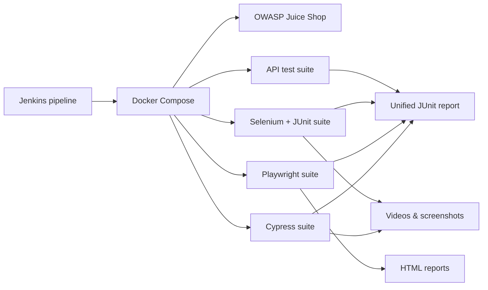

# Alexsander Corvello da Silveira

### Senior QA Engineer · Test Automation · Data Analysis & Applied AI

📍 São Leopoldo, Brazil &nbsp;|&nbsp; 🧪 10+ years in software quality &nbsp;|&nbsp; 📊 Data analysis with machine learning &nbsp;|&nbsp; 🤖 Bringing generative AI into the testing lifecycle

---

## 👋 About me

I'm a **Senior QA Engineer / SDET** with more than a decade of experience in software testing and quality assurance. I started with manual and functional testing, moved into **test automation** (Selenium, Cypress, Playwright), and today I focus on a question I find fascinating:

> **How can AI make testing faster, smarter and more reliable, without giving up control over sensitive project data?**

That question drives most of my current work: generating test scenarios from user stories with LLMs, predicting software failures before deployment, validating test suites with AI agents, and running **local LLMs** (Ollama) so project data never has to leave the machine.

Alongside quality engineering, I work with **data analysis and applied machine learning**. I build reproducible Jupyter notebooks that go from raw data to audited models, covering **deep reinforcement learning**, **unsupervised learning** and **association-rule mining**. The two sides feed each other: QA habits such as reproducibility, validation and skepticism about "green" results carry over into how I audit models, and data analysis gives me the tools to measure quality instead of guessing it.

I'm currently pursuing an **MBA in Applied Artificial Intelligence (UNISINOS, 2026)** and I'm **open to opportunities** as a Senior QA Engineer, SDET, or Quality Specialist with an AI focus.

---

## 🛠️ Tech stack

| Area | Tools |
|---|---|
| **Test automation (UI)** | Playwright (Python), Cypress (JavaScript), Selenium (Java) |
| **API testing** | pytest, requests, Postman, RestAssured |
| **Test management** | Zephyr (Jira) |
| **Performance & security (foundational)** | JMeter, k6, OWASP awareness |
| **Languages** | Python, JavaScript, Java |
| **CI/CD & infrastructure** | Jenkins, Docker, Docker Compose, GitHub |
| **Methodologies** | BDD, Scrum, Kanban, continuous integration |
| **Messaging & data** | Kafka, PostgreSQL, Oracle/SQL, Azure Blob Storage |
| **Data analysis & ML** | pandas, NumPy, SciPy, scikit-learn, mlxtend |
| **Deep learning & RL** | PyTorch, Gymnasium, Stable-Baselines3 |
| **Visualization & notebooks** | Matplotlib, Seaborn, Plotly, Jupyter |
| **AI & LLMs** | LangChain, LangGraph, Ollama (local LLMs), prompt engineering |

---

## 🚀 Featured projects

### 🔧 Test automation portfolio, built against OWASP Juice Shop

Four independent test suites that validate the same target application ([OWASP Juice Shop](https://owasp.org/www-project-juice-shop/)), all executed by one containerized Jenkins pipeline.

| Repository | What it is | Stack |
|---|---|---|
| [**e2e-cypress-js**](https://github.com/acorvello/e2e-cypress-js) | End-to-end UI tests for the login flow, with video and failure screenshots | Cypress, JavaScript |
| [**e2e-playwright-python**](https://github.com/acorvello/e2e-playwright-python) | Cross-browser UI tests (Chromium, Firefox, WebKit) with HTML and JUnit reports | Playwright, pytest, Python |
| [**e2e-selenium-java**](https://github.com/acorvello/e2e-selenium-java) | UI tests with the Page Object Model, explicit waits and screenshot on failure | Selenium 4, JUnit 5, Java, Maven |
| [**api-testing**](https://github.com/acorvello/api-testing) | REST API tests covering products, authentication and user registration | pytest, requests, Python |

**What makes it more than four test folders:**

- 🐳 **Everything runs in Docker.** The target app, each test runner, the Selenium browser and Jenkins itself are containers, so the whole environment is reproducible on any machine.
- 🔁 **One Jenkins pipeline** brings up the app, runs the four suites independently (a failure in one never blocks the others) and tears everything down.
- 📊 **Unified reporting.** JUnit results from all suites are merged into Jenkins' native test report, while videos, screenshots and HTML reports are archived per build.
- 🧩 **Test code lives in separate repositories** from the infrastructure, the same way real teams separate them.

### 📊 Data analysis & applied AI: [data-analysis](https://github.com/acorvello/data-analysis)

A collection of reproducible Jupyter notebooks that apply AI methods to very different domains, each with diagnostics and visualizations built in. Two examples:

#### 🚀 Lunar Lander v3: deep reinforcement learning benchmark

Trains and audits agents that read spacecraft telemetry and fire thrusters in a coordinated way to land safely, using the Gymnasium Lunar Lander v3 environment.

- **Three algorithm families compared:** DQN (value-based), PPO (policy gradient) and A2C (actor-critic), all from Stable-Baselines3, trained for 300k timesteps under independent seeds.
- **Stable training:** adaptive reward normalization (`VecNormalize`) tames the noisy +100 / -100 landing and crash rewards.
- **100% in-memory pipeline:** environments, buffers, logs and convergence history live in RAM, with no disk writes during training.
- **Policy health auditing:** the Shannon entropy of each agent's actions measures how much behavioral variety is left after training, flagging *policy collapse*.

| Algorithm | Mean reward | Safe landing rate | Action entropy | Policy health |
|:---:|:---:|:---:|:---:|:---:|
| 🏆 **PPO** | **+184.20** | **93.3%** | 1.91 bits (max 2.00) | Healthy and dynamic |
| **A2C** | -42.10 | 15.0% | 1.10 bits | Late degradation |
| **DQN** | -125.40 | 0.0% | 0.32 bits | Collapse alert |

#### 🛡️ Unsupervised cyber threat intelligence

Turns raw, unlabeled corporate firewall logs into entity-level behavior profiles and surfaces signs of network reconnaissance and automated scanning.

- **Behavior profiles per source IP:** the view shifts from individual packets to a behavioral matrix per `Src IP`.
- **Unsupervised feature selection:** a low-variance filter plus automatic pruning of highly correlated features (above 0.85) removes geometric bias from distance calculations.
- **Three clustering families compared:** K-Means, hierarchical clustering (Ward) and DBSCAN, ranked with Silhouette, Davies-Bouldin and Calinski-Harabasz. DBSCAN isolates anomalies as standalone noise.
- **Interactive manifold views:** 2D PCA and t-SNE with Plotly, with tooltips showing each suspicious source IP.
- **Association-rule mining:** Apriori and FP-Growth recover the same network signatures, with a lift above 7.

**Tools:** Python, pandas, NumPy, scikit-learn, SciPy, mlxtend, PyTorch, Gymnasium, Stable-Baselines3, Matplotlib, Seaborn, Plotly, Jupyter.

### 🤖 AI applied to software quality

Projects where generative AI and machine learning meet testing:

- **AI-generated test scenarios**: automatically producing test cases from user stories using LLMs.
- **Cypress suite validator**: an agent built with **LangChain + LangGraph** that reviews Cypress test suites for best practices, flaky logic and fragile selectors, then produces a structured report.
- **Failure prediction model**: a model trained on test execution logs to estimate the probability of a software failure *before* deployment (academic project, MBA in Applied AI).
- **Local AI for test development**: running **Ollama** with a local model, connected to VS Code, to help write automation code while keeping project data under my own governance.

---

## 🧠 What I've learned along the way

The most valuable part of these projects isn't the green pipeline or the final chart, it's the debugging and auditing that got them there. A few lessons that came straight from real work:

- **Visibility is not the same as clickability.** Modal overlays and animated menus can make an element "visible" but unclickable. Cypress and Playwright handle this differently (`force`, `trigger` and `dispatch_event` are *not* interchangeable), and knowing why matters more than knowing the flag.
- **Retry-ability beats fixed waits.** Replacing `cy.wait(1000)` with an assertion that Cypress retries automatically removed an entire class of flaky failures.
- **Pin your versions.** An unpinned `@playwright/test` silently drifted away from the browsers baked into the Docker image and broke every test at once.
- **Containers talking to containers is its own problem.** Running Docker from inside Jenkins on Windows required understanding how paths are resolved by the daemon, not just by the client.
- **Read the screenshot.** After several rounds of educated guessing, a single failure screenshot revealed the real cause in seconds.
- **Look beyond the headline metric.** In the reinforcement-learning benchmark, tracking the entropy of each agent's actions adds a second view of its health on top of the reward.
- **Clean the features before measuring distance.** In the clustering pipeline, removing highly correlated variables keeps distance-based algorithms from being biased by redundant signals.

---

## 🎓 Education

- **MBA in Applied Artificial Intelligence**: UNISINOS (in progress, 2026)
- **Postgraduate degree in Project Management**: UNISINOS (2022)
- **Bachelor's degree in Information Systems**: UNISINOS (2010)

---

## 📫 Let's connect

I'm open to opportunities in **software quality engineering, test automation and AI-driven testing**, and always happy to talk about QA, automation strategy, data analysis, or using AI responsibly.

- 💼 **LinkedIn:** [linkedin.com/in/acorvello](https://www.linkedin.com/in/acorvello)
- 📧 **Email:** [alexsander.corvello@gmail.com](mailto:alexsander.corvello@gmail.com)
- 🐙 **GitHub:** [@acorvello](https://github.com/acorvello)

---

Keywords: Senior QA Engineer, SDET, Test Automation Engineer, Quality Engineering, Data Analysis, Machine Learning, Deep Reinforcement Learning, Unsupervised Learning, Clustering, Anomaly Detection, Playwright, Cypress, Selenium, pytest, API Testing, Jenkins, Docker, CI/CD, BDD, AI in Software Testing, Generative AI Testing, LLM Test Generation, LangChain, LangGraph, Ollama, scikit-learn, pandas, PyTorch, Stable-Baselines3, Plotly, Jupyter, Brazil.
